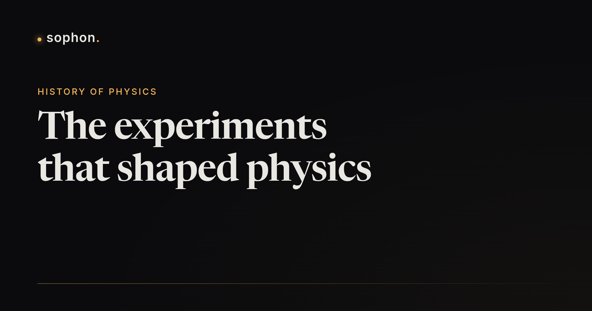

# Sophon

**The experiments that shaped physics** — an interactive, bilingual (Vietnamese / English) history of physics.

**→ [sophon.jasonng-1407.workers.dev](https://sophon.jasonng-1407.workers.dev)** · [Tiếng Việt](https://sophon.jasonng-1407.workers.dev/vi/) · [English](https://sophon.jasonng-1407.workers.dev/en/)



## About

Sophon retells the history of physics one experiment at a time, in the order it happened. Each episode covers a single experiment or discovery: what people believed at the time, what did not fit, who worked it out, and a simulation in the browser that lets you redo the experiment yourself.

Historical accuracy comes first. Dates, quotations and attributions are sourced from the original papers and from established histories of science, and each episode points out where popular accounts get the story wrong.

## Episodes

Arc 1 — The quantum crisis (1900–1927)

| # | Episode | Years | Simulation |
|---|---------|-------|------------|
| 1 | [Blackbody radiation](https://sophon.jasonng-1407.workers.dev/en/01-blackbody) | 1859–1900 | Colour of hot objects, the classical divergence, the 1900 infrared data |
| 2 | [The photoelectric effect](https://sophon.jasonng-1407.workers.dev/en/02-photoelectric) | 1887–1916 | Light quanta vs. work function; measure h/e like Millikan |
| 3 | [Rutherford scattering](https://sophon.jasonng-1407.workers.dev/en/03-rutherford) | 1909–1913 | Alpha particles on a gold foil; Thomson vs. Rutherford atom |
| 4 | [The Bohr model and hydrogen lines](https://sophon.jasonng-1407.workers.dev/en/04-bohr) | 1885–1913 | Electron jumps on an energy ladder; the hydrogen spectrum |
| 5 | [The Stern–Gerlach experiment](https://sophon.jasonng-1407.workers.dev/en/05-stern-gerlach) | 1921–1927 | A silver beam splitting in two on Gerlach's plate; magnets in series |

More episodes follow: de Broglie, Schrödinger, Heisenberg, Davisson–Germer and the 1927 Solvay conference.

## Features

- **Interactive simulations** written from scratch in plain JavaScript and canvas, one per episode.
- **Two reading depths**: a short summary, a prediction question and a quiz for newcomers; derivations and sources one click away.
- **Python notebooks** in [`lab/`](lab/) that derive and check the physics, runnable in Google Colab without installing anything.
- **Physics checks**: every simulation's formulas are tested against limiting cases and known values.
- **Comments** without accounts, so readers can ask questions and send corrections.

## Tech stack

Static HTML, CSS and vanilla JavaScript modules, with no framework and no build step. Maths is rendered with [KaTeX](https://katex.org). The site is served by [Cloudflare Workers](https://workers.cloudflare.com); a small Worker with a D1 database handles comments. Notebooks use NumPy, SciPy and Matplotlib.

## Running locally

```bash
git clone https://github.com/JasonDE03/sophon.git
cd sophon
python3 -m http.server 8000      # open http://localhost:8000
node check.mjs                   # physics checks, prints "ok"
```

Comments only work on the deployed site. To run the notebooks locally, see [`lab/README.md`](lab/README.md).

## Project structure

```
vi/, en/          episode pages and home pages, one folder per language
sims/             one simulation module per episode, shared by both languages
lab/              Python notebooks (Colab-ready)
check.mjs         physics checks for the simulations
style.css         site styles
learn.js          summaries, questions, glossary and table of contents
comments.js       comment section (client)
worker.js         comment API (Cloudflare Worker + D1)
tools/            page and share-image generators
og/               share images
```

## Contributing

Found a historical or physics error? Please [open an issue](https://github.com/JasonDE03/sophon/issues) with a source, or leave a comment under the episode. Corrections are very welcome.

## License

- **Code** (simulations, scripts, Worker, notebooks): [MIT](LICENSE).
- **Content** (article text in `vi/` and `en/`, and the images in `og/`): [CC BY-NC 4.0](LICENSE-CONTENT.md). Free to reuse with credit for non-commercial purposes; ask for commercial use.

## Author

Nguyen Phan Nam Son · [Facebook](https://www.facebook.com/nam.son.178624/) · [Instagram](https://www.instagram.com/fet.sofn/)
